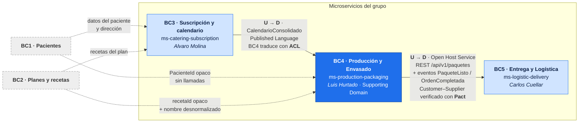
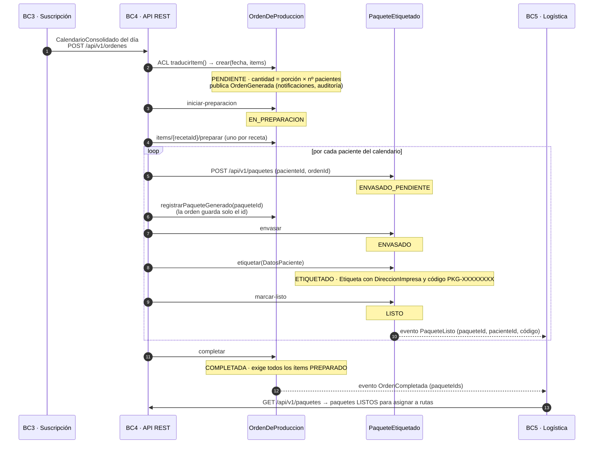
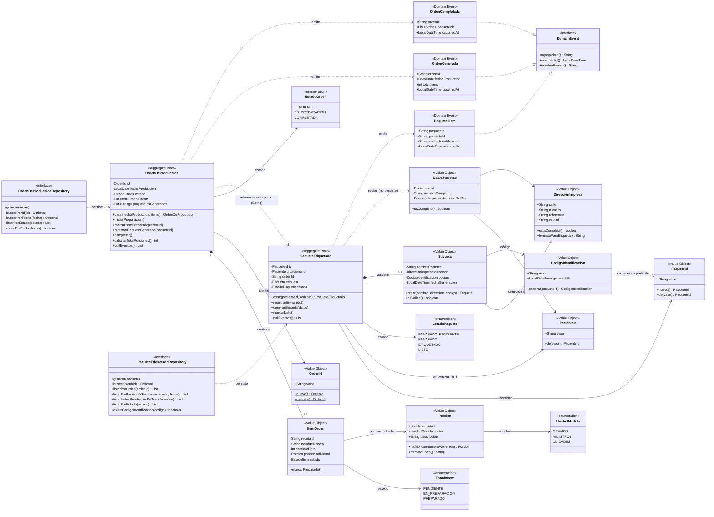

# ms-production-packaging

> **Bounded Context:** BC4 · Producción y preparación
> **Clasificación DDD:** Supporting Domain
> **Stack:** Spring Boot 3.4, Maven, Java 21
> **Alcance de este módulo:** únicamente la capa de dominio (`domain/`) — Java puro, sin anotaciones de framework.

## Propósito

Gestiona la generación de órdenes de trabajo a partir del `CalendarioConsolidado` publicado por BC3, la preparación de porciones en cocina, el envasado y el etiquetado de paquetes listos para transferirse a BC5 (Entrega y Logística).

- Recibe el evento `CalendarioConsolidado` y genera la `OrdenDeProduccion`.
- Calcula la cantidad total de cada receta: `porción × nro. de pacientes`.
- Gestiona el ciclo de vida de la orden: `PENDIENTE → EN_PREPARACION → COMPLETADA`.
- Registra el envasado y genera el `PaqueteEtiquetado` por paciente.
- Emite los eventos de dominio: `OrdenGenerada`, `OrdenCompletada`, `PaqueteListo`.

## Diseño estratégico — Context Map

BC4 está en el medio de la cadena de valor: **aguas abajo** del calendario (BC3), del que
recibe qué cocinar y para quién, y **aguas arriba** de la logística (BC5), a la que entrega
los paquetes listos. Con BC1 y BC2 no tiene ninguna dependencia en tiempo de ejecución: solo
guarda sus identificadores como referencias opacas.



| Relación | Patrón DDD | Qué significa en el código |
| :------- | :--------- | :------------------------- |
| BC3 → BC4 | *Upstream / Downstream* + **Anti-Corruption Layer** | El calendario llega con el lenguaje de BC3; `OrdenApplicationService.traducirItem()` lo traduce a `ItemOrden` y `Porcion`. El dominio de BC4 nunca ve un objeto de BC3. |
| BC4 → BC5 | **Open Host Service** + **Published Language** · *Customer–Supplier* | BC4 expone `GET /api/v1/paquetes` y publica `PaqueteListo` y `OrdenCompletada`. BC5 (el cliente) fija lo que necesita en un pacto, y BC4 lo verifica en `PaquetesProviderContractIT`. |
| BC1 ⇢ BC4 | Referencia por identidad | `PacienteId` es un VO opaco. El nombre y la dirección llegan **desnormalizados** desde BC3: si BC1 cae, la cocina sigue produciendo. |
| BC2 ⇢ BC4 | Referencia por identidad | `ItemOrden` guarda `recetaId` y una copia de `nombreReceta`; BC4 nunca consulta el catálogo. |

> BC1 y BC2 (en gris) forman parte del modelo del proyecto, pero ningún integrante del grupo
> los implementó como microservicio. Las líneas punteadas son dependencias de datos, no llamadas.

### Cómo se origina y avanza el flujo a partir de una orden de producción



La **orden de producción** es el agregado raíz que origina todo: se crea a partir del
calendario, la cocina la avanza ítem por ítem, y cada paquete que se genera queda
**referenciado por su id** en la orden (nunca como objeto: son dos agregados con ciclos de
vida propios). El paquete se crea *antes* de completar la orden, porque una orden
`COMPLETADA` es inmutable. Este recorrido es el que prueban los flujos de integración A y B
(ver [Pruebas de integración](#pruebas-de-integración)).

> **Estado de la implementación.** BC3 entrega el calendario a BC4 llamando a
> `POST /api/v1/ordenes`, y BC5 recoge los paquetes por REST (el contrato Pact). Los eventos de
> dominio se publican hoy en el bus interno de Spring (`SpringEventPublisher`); llevarlos a
> BC5 por RabbitMQ, que BC5 ya tiene levantado, es cambiar solo ese adaptador de
> infraestructura, sin tocar el dominio.

## Diagrama de clases — Diseño táctico DDD



> Las excepciones de dominio (`OrdenSinItemsException`, `TransicionEstadoInvalidaException`, `EtiquetaInvalidaException`, etc.) se omiten del diagrama para no saturarlo. Están documentadas en la tabla de invariantes más abajo y coubicadas junto al agregado que las lanza.

### Lectura del diagrama

- **Agregados raíz:** `OrdenDeProduccion` y `PaqueteEtiquetado`. Cada uno controla su propio ciclo de vida y solo se referencian entre sí **por Id** (`String`), nunca por objeto — así se preserva la consistencia transaccional de cada agregado.
- **Value Objects de identidad:** `OrdenId`, `PaqueteId` (identidad propia del dominio) y `PacienteId` (referencia opaca a BC1).
- **Value Objects de datos:** `ItemOrden`, `Porcion`, `Etiqueta`, `DireccionImpresa`, `CodigoIdentificacion`, `DatosPaciente` — inmutables y autovalidados en su constructor.
- **Eventos de dominio:** implementan la interfaz `DomainEvent` y se acumulan en el agregado (patrón *pull*); la capa de aplicación los extrae con `pullEventos()` y los publica al bus. El dominio no conoce el bus de mensajes.
- **Puertos de repositorio:** interfaces en `domain/repository`; la implementación concreta (JPA, Mongo, etc.) vive en infraestructura, fuera del alcance de este módulo.

## Estructura de paquetes

```
com.nurticenter.produccion
└── domain
    ├── DomainException.java
    ├── model
    │   ├── orden
    │   │   ├── OrdenDeProduccion.java          ← Agregado raíz
    │   │   ├── OrdenId.java                    ← VO (identidad)
    │   │   ├── ItemOrden.java                  ← VO
    │   │   ├── EstadoOrden.java                ← VO (enum)
    │   │   ├── EstadoItem.java                 ← VO (enum)
    │   │   └── *Exception.java                 ← excepciones coubicadas
    │   └── paquete
    │       ├── PaqueteEtiquetado.java          ← Agregado raíz
    │       ├── PaqueteId.java                  ← VO (identidad)
    │       ├── PacienteId.java                 ← VO (ref. externa BC1)
    │       ├── Etiqueta.java                   ← VO
    │       ├── DireccionImpresa.java           ← VO
    │       ├── CodigoIdentificacion.java       ← VO
    │       ├── DatosPaciente.java              ← VO
    │       ├── EstadoPaquete.java              ← VO (enum)
    │       └── *Exception.java                 ← excepciones coubicadas
    ├── shared
    │   ├── Porcion.java                        ← VO compartido
    │   └── UnidadMedida.java                   ← VO (enum)
    ├── event
    │   ├── DomainEvent.java                    ← Interfaz base
    │   ├── OrdenGenerada.java
    │   ├── OrdenCompletada.java
    │   └── PaqueteListo.java
    └── repository
        ├── OrdenDeProduccionRepository.java    ← Puerto
        └── PaqueteEtiquetadoRepository.java    ← Puerto
```

## Invariantes principales

| # | Invariante | Agregado | Excepción |
|---|------------|----------|-----------|
| 1 | Una orden debe tener al menos un `ItemOrden` | `OrdenDeProduccion` | `OrdenSinItemsException` |
| 2 | Una orden `COMPLETADA` es inmutable | `OrdenDeProduccion` | `OrdenYaCompletadaException` |
| 3 | Solo se completa si todos los ítems están `PREPARADO` | `OrdenDeProduccion` | `ItemsPendientesException` |
| 4 | Las transiciones de estado solo avanzan | Ambos | `TransicionEstadoInvalidaException` |
| 5 | El envasado precede al etiquetado | `PaqueteEtiquetado` | `EtiquetaSinEnvasadoException` |
| 6 | La `Etiqueta` debe ser válida antes de marcar `LISTO` | `PaqueteEtiquetado` | `EtiquetaInvalidaException` |
| 7 | Los `DatosPaciente` deben estar completos | `PaqueteEtiquetado` | `DatosPacienteIncompletosException` |

Documentación completa del dominio: [`.agents/bc4-domain-docs`](../../.agents/bc4-domain-docs).

## Build y pruebas

> **Proyecto Final — capa de testing completa.** Un solo comando ejecuta todos los niveles
> y deja los reportes entregables en [`docs/reportes/`](docs/reportes):
>
> ```powershell
> .\tools\run-all-tests.ps1          # unitarias + integración (Java y Postman) + contrato
> ```
>
> Mapa requisito → evidencia y cómo ejecutarlo: [`docs/proyecto-final-testing.md`](docs/proyecto-final-testing.md).
> Reglas de proyecto usadas para generar los tests con IA: [`CLAUDE.md`](CLAUDE.md).

```bash
cd ms-production-packaging

./mvnw test                  # 163 pruebas unitarias + reporte de cobertura JaCoCo
./mvnw verify                # además valida el umbral mínimo (85 % líneas / 80 % ramas)
./mvnw -Pintegration verify  # además, los flujos de integración en Java
```

Reporte de cobertura: `target/site/jacoco/index.html` (requiere JDK 21). Copia versionada:
[`docs/reportes/coverage-unitarias/index.html`](docs/reportes/coverage-unitarias/index.html).

**163 pruebas unitarias** cubren las tres capas, sin levantar Spring ni base de datos:

| Capa | Enfoque | Cobertura de líneas |
| :--- | :------ | ------------------: |
| Dominio | Java puro, sin dobles: invariantes, transiciones de estado y eventos | 99.2 % |
| Aplicación | **Mocks de Mockito** de los puertos (`OrdenDeProduccionRepository`, `PaqueteEtiquetadoRepository`, `EventPublisher`) para verificar la orquestación; además un **fake** en memoria para el flujo completo | 100 % |
| Infraestructura | **Mocks** de Spring Data JPA, del `ApplicationEventPublisher` y de los servicios de aplicación (adaptadores, mappers, controllers, manejo de errores) | 97.8 % |

Cobertura global: **98.7 % de líneas / 99.1 % de ramas** (mínimo exigido: 80 %).

Detalle de la estrategia, herramientas y mapa de pruebas: [`docs/pruebas-unitarias.md`](docs/pruebas-unitarias.md).

### Pruebas de integración

Las pruebas de integración no viven en `mvn test` (surefire excluye `*IT.java` a
propósito). Están **agrupadas por flujo de negocio** y existen en dos formas: una colección
de Postman contra el microservicio **realmente levantado**, y los mismos flujos en Java.

| Flujo | Postman | Java | Qué recorre |
| :---- | :------ | :--- | :---------- |
| **A — Producción en cocina** | `01 - Flujo A` (10 requests) | `FlujoProduccionIT` | orden generada → consultada por id y fecha → EN_PREPARACION → ítems preparados → COMPLETADA |
| **B — Envasado y entrega a BC5** | `02 - Flujo B` (11 requests) | `FlujoEnvasadoIT` | paquete → envasado → etiquetado → LISTO → visible para Logística → orden completada con el paquete |
| **C — Rechazos** | `03 - Flujo C` (11 requests) | un test de rechazo en cada clase | 400 / 404 / 409 con su `ApiError`, sin dejar estado a medias |

```powershell
# desde la raíz del repositorio (ddd_clean)
.\tools\validate-integration.ps1                          # Docker + PostgreSQL real efímero
.\tools\validate-integration.ps1 -Mode local -Twice -Report   # H2, dos vueltas, reporte HTML

cd ms-production-packaging; .\mvnw.cmd -Pintegration verify   # los flujos en Java
```

Resultado medido: Postman **32 requests, 92 aserciones, 0 fallos** en dos vueltas seguidas
contra la misma base de datos; Java **4 tests, 0 fallos**, que además verifican los eventos
de dominio (`OrdenGenerada`, `OrdenCompletada`, `PaqueteListo`) que desde HTTP no se ven.

Cómo levantarlo y lanzarlo: [`postman/README.md`](postman/README.md) y
[`docs/pruebas-integracion.md`](docs/pruebas-integracion.md).

### Pruebas de contrato (Pact)

Un nivel por encima de la integración: las pruebas de integración comprueban que BC4
funciona; las de contrato comprueban que **BC5 puede consumirlo**. El consumidor
(`ms-logistic-delivery`) declara lo que necesita, eso genera un **pacto**, y BC4 demuestra
contra sí mismo que lo cumple — sin levantar los dos servicios a la vez.

```powershell
# desde la raíz del repositorio (ddd_clean)
.\tools\validate-contracts.ps1                # consumidor -> pacto -> proveedor
.\tools\validate-contracts.ps1 -BreakCheck    # además, exige que el pacto alterado FALLE
```

Resultado medido: **4 interacciones** en el pacto (3 de éxito + 1 de error 404),
**4 de 4 verificadas** por el proveedor, y falsabilidad comprobada. No necesita Docker: la
verificación levanta BC4 con el perfil `it` (H2 en memoria).

| Lado | Dónde | Qué aporta |
| :--- | :---- | :--------- |
| Consumidor (BC5) | `contract-testing/bc5-logistic-consumer` | El cliente HTTP real y las 4 interacciones que declara necesitar |
| Pacto | `ms-production-packaging/src/test/resources/pacts` | El artefacto generado — no se edita a mano |
| Proveedor (BC4) | `…/src/test/java/…/contract/PaquetesProviderContractIT.java` | Los `@State` y la verificación con la app levantada |

Guía completa: [`docs/pruebas-contrato.md`](docs/pruebas-contrato.md).

### Entorno de pruebas asistido por IA

El repositorio incluye tres entornos validados para generar y auditar pruebas con IA, uno
por nivel de prueba.

**Unitarias** — dos subagentes (`test-writer`, `test-reviewer`), tres skills con las
convenciones del proyecto, un gate reproducible (`tools/validate-tests.ps1` / `.sh`) y
verificación objetiva por *mutation testing* con PIT.

```powershell
# desde la raíz del repositorio (ddd_clean)
.\tools\validate-tests.ps1              # compila + suite + umbral de cobertura
.\tools\validate-tests.ps1 -Mutation    # además, mutation testing
```

Resultado medido (25/09/2026): **163 tests**, 98.7 % de líneas y **154/156 mutantes muertos** (99 %);
los 2 supervivientes son `hashCode()` equivalentes. Reporte: `docs/reportes/mutation-pit/index.html`.
La primera pasada de PIT detectó 12 huecos de verificación que la cobertura no veía —
entre ellos, que se podía borrar la publicación de eventos de dominio sin que fallara
ningún test.

Guía completa: [`docs/entorno-pruebas-ai.md`](docs/entorno-pruebas-ai.md).

**Integración** — dos subagentes (`integration-test-writer`, `integration-test-reviewer`),
cuatro skills (el contrato de la API, las convenciones de la colección, las de los flujos en
Java —`spring-integration-testing`— y la lista de revisión)
y un gate que levanta el ambiente y ejecuta la colección
(`tools/validate-integration.ps1` / `.sh`).

```powershell
.\tools\validate-integration.ps1 -Mode local -Twice   # exige dos vueltas en verde
```

Aquí la verificación que no se puede falsificar no es el *mutation testing*, sino la
**repetibilidad**: una colección que solo pasa con la base de datos recién creada no es una
prueba, y es un fallo que el resumen en verde de la primera vuelta no muestra.

Guía completa: [`docs/pruebas-integracion.md`](docs/pruebas-integracion.md).

**Contrato** — dos subagentes (`pact-writer`, `pact-reviewer`), dos skills propios
(convenciones de Pact en este proyecto y la lista de revisión adversarial) más el contrato
de la API ya existente, y un gate que recorre el ciclo completo
(`tools/validate-contracts.ps1` / `.sh`).

```powershell
.\tools\validate-contracts.ps1 -BreakCheck   # exige que el pacto alterado haga fallar la verificación
```

Aquí la verificación que no se puede falsificar es la **falsabilidad del propio pacto**: el
gate altera una expectativa del contrato y exige que la verificación se caiga. Si pasa
igual, el pacto tenía todo el cuerpo en *matchers* de tipo y no comprobaba nada — el fallo
característico de un contrato generado por IA, e invisible en el resumen verde.

Guía completa: [`docs/pruebas-contrato.md`](docs/pruebas-contrato.md).
